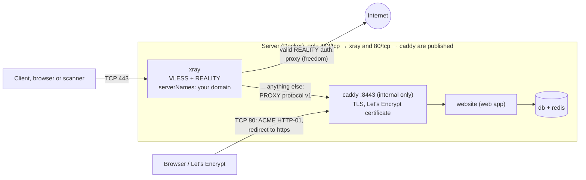

# Architecture

[Русский](ru/architecture.md) | **English**

How the stack fits together, and the rules that keep it working. Read this before
changing anything in `templates/`.

## Traffic flow

Xray owns TCP 443. A client with valid REALITY credentials gets the proxy. Every
other connection (browsers, scanners, active probes) is handed, byte for byte, to
Caddy, which serves a real website with a genuine Let's Encrypt certificate for
`<domain>`. To an observer the server is an ordinary HTTPS site, and heavy traffic
to a self-hosted web app (file sync, media) is unremarkable.

Services (`templates/compose.yml`): `xray`, `caddy`, `db` (MariaDB), `redis` and the
website's web app. All state lives in `./data/*` bind mounts.

## Templates and rendering

All config is in `templates/` with `{{VARIABLE}}` placeholders; `install.sh` renders
it on the server (variables and rules: [templates/README.md](../templates/README.md)).
Rendered files (`.env`, `compose.yml`, `Caddyfile`, `xray/`, `clients/`) and `data/`
exist only on the server and are git-ignored. Change config in `templates/`, never
only in a rendered file.

## Invariants: keep these in sync or things break

1. The domain comes only from `{{DOMAIN}}`; never hardcode it in a template. It
   becomes the website hostname in `.env`, REALITY `serverNames`, and the client
   SNI / address.
2. `realitySettings.target` is `caddy:8443`, and Caddy's `https_port` is `8443`.
3. `realitySettings.xver: 1` (Xray sends PROXY protocol) ⇔ Caddy's `proxy_protocol`
   listener wrapper. Remove both or neither; a mismatch breaks the fallback website.
4. Port 8443 is never published to the host. Only 80/tcp (caddy) and 443/tcp
   (xray) are. Docker-published ports bypass `ufw`, so no other service may have
   `ports:`.
5. Every VLESS client has `"flow": "xtls-rprx-vision"`.
6. One REALITY key pair for the whole server: `privateKey` stays in
   `xray/server.json`; the public key ("Password" in `xray x25519` output) goes to
   every client.
7. Each client has a unique UUID and a unique `email` label, and its own entry in
   `shortIds` (hex, even length, ≤ 16 chars). `remove_user.sh` finds a client's
   short ID through `clients/<email>.config.json`.

## Memory budget (1 GB RAM)

The web app officially wants ≥ 2 GB; the stack fits 1 GB RAM + 2 GB swap with hard
limits in compose:

| Service | Limit | Tuning |
|---|---|---|
| xray | 96m | |
| caddy | 96m | |
| db | 192m | 32M InnoDB buffer pool, performance_schema off, 30 connections |
| redis | 64m | 32 MB maxmemory, LRU, no persistence |
| web app | 640m | worker count lowered after first start (hint printed by `install.sh`) |

Optional web app components (document editor etc.) are disabled to stay in budget.
Check `free -m` and `docker stats --no-stream` before adding anything.

## Secrets

All generated by `install.sh`: database passwords and JWT key are
`openssl rand -hex 32` (64 hex chars); REALITY keys come from `xray x25519`
(x25519 keys are always 43 chars); client UUIDs from
`/proc/sys/kernel/random/uuid`; short IDs `openssl rand -hex 8`. Never re-run
`install.sh` on a started server: new database secrets would lock the web app out
of its database.

## Design decisions and gotchas

- **HTTP/3 is off**: xray owns 443/tcp; Caddy cannot cleanly serve QUIC on the same
  port, and a QUIC-capable site that never answers on UDP would look odd.
- **BitTorrent is blocked** in the xray routing rules (hosting providers act on
  abuse complaints), and so are private IP ranges (`geoip:private`), so clients
  cannot reach the server's internal network.
- **Port 80 must be reachable** and DNS must point at the server before the first
  start, or the first certificate cannot be issued. On HSTS-preloaded TLDs (e.g.
  `.dev`) browsers never use plain HTTP; Caddy only redirects.
- **LF line endings** everywhere (`.gitattributes`): a CRLF `.env` adds `\r` to every
  value, and CRLF shell scripts fail on Linux.
- **`.env` values are single-quoted**, so compose does not interpolate `$` in
  passwords.
- REALITY `target` was formerly called `dest`; both names work in current xray.
- **Clients** must be xray-core based (v2fly `v2ray` has no REALITY / Vision). The
  desktop config listens on `127.0.0.1` only (SOCKS 10808, HTTP 10809) and uses
  `domainStrategy: AsIs`, so unmatched domains are resolved by the server, not
  leaked to local DNS.
