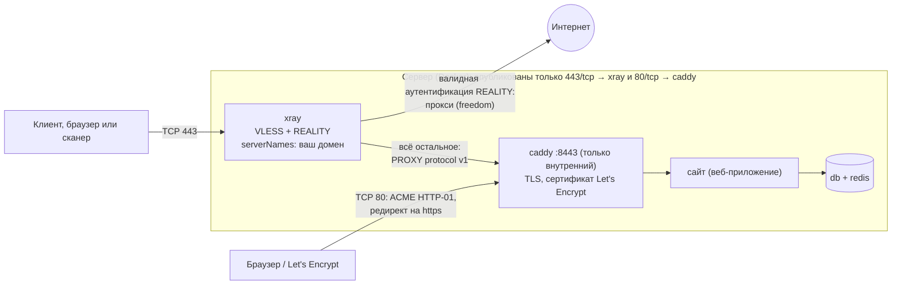

# Архитектура

**Русский** | [English](../architecture.md)

Как устроен стек и какие правила обеспечивают его работу. Прочитайте это, прежде чем
что-либо менять в `templates/`.

## Поток трафика

Xray владеет TCP 443. Клиент с валидными учётными данными REALITY получает прокси. Любое
другое соединение (браузеры, сканеры, активные пробы) передаётся байт в байт
в Caddy, который отдаёт настоящий сайт с подлинным сертификатом Let's Encrypt для
`<domain>`. Для наблюдателя сервер — обычный HTTPS-сайт, а большой объём трафика
к самостоятельно размещённому веб-приложению (синхронизация файлов, медиа) ничем не примечателен.

Сервисы (`templates/compose.yml`): `xray`, `caddy`, `db` (MariaDB), `redis` и
веб-приложение сайта. Всё состояние хранится в bind mount `./data/*`.

Сервисы разнесены по трём сетям Docker, поэтому у прокси нет маршрута к
бэкендам:

| Сеть | Участники | Примечания |
|---|---|---|
| `edge` | xray, caddy | единственный сосед xray — caddy |
| `web` | caddy, веб-приложение | |
| `backend` | веб-приложение, db, redis | `internal: true`, нет маршрута в интернет |

## Шаблоны и рендеринг

Весь конфиг находится в `templates/` с плейсхолдерами `{{VARIABLE}}`; `install.sh` рендерит
его на сервере (переменные и правила: [templates/README.md](../../templates/README.md)).
Отрендеренные файлы (`.env`, `compose.yml`, `Caddyfile`, `xray/`, `clients/`) и `data/`
существуют только на сервере и находятся в git-ignore. Меняйте конфиг в `templates/`, а не
только в отрендеренном файле.

## Инварианты: держите их согласованными, иначе всё сломается

1. Домен берётся только из `{{DOMAIN}}`; никогда не прописывайте его в шаблоне жёстко. Он
   становится именем хоста сайта в `.env`, REALITY `serverNames` и SNI / адресом
   клиента.
2. `realitySettings.target` равен `caddy:8443`, а `https_port` у Caddy равен `8443`.
3. `realitySettings.xver: 1` (Xray отправляет PROXY protocol) ⇔ обёртка слушателя
   `proxy_protocol` у Caddy. Удаляйте обе или ни одну; несоответствие ломает резервный сайт.
4. Порт 8443 никогда не публикуется на хост. Публикуются только 80/tcp (caddy) и 443/tcp
   (xray). Порты, опубликованные Docker, обходят `ufw`, поэтому ни у какого другого сервиса не должно быть
   `ports:`.
5. У каждого клиента VLESS есть `"flow": "xtls-rprx-vision"`.
6. Одна пара ключей REALITY на весь сервер: `privateKey` остаётся в
   `xray/server.json`; публичный ключ ("Password" в выводе `xray x25519`) выдаётся
   каждому клиенту.
7. У каждого клиента уникальный UUID, уникальная метка `email` и собственная запись в
   `shortIds` (hex, чётной длины, ≤ 16 символов). `remove_user.sh` находит short ID клиента
   через `clients/<email>.config.json`.
8. xray находится в одной сети только с caddy. Никогда не подключайте `xray` к `web` или
   `backend` и не удаляйте списки `networks:` (compose вернёт все сервисы
   в одну общую сеть): db и redis доверяют своей сети.
9. В серверном `routing` сохраняются `domainStrategy: IPIfNonMatch` и правило,
   блокирующее имена хостов без точки. Без них правило `geoip:private` пропускается
   для любого назначения, заданного именем хоста.

## Бюджет памяти (1 ГБ RAM)

Веб-приложению официально нужно ≥ 2 ГБ; стек укладывается в 1 ГБ RAM + 2 ГБ swap благодаря жёстким
лимитам в compose:

| Сервис | Лимит | Настройка |
|---|---|---|
| xray | 96m | |
| caddy | 96m | |
| db | 192m | буферный пул InnoDB 32M, performance_schema выключена, 30 соединений |
| redis | 64m | maxmemory 32 МБ, LRU, без персистентности |
| веб-приложение | 640m | число воркеров уменьшается после первого запуска (рекомендацию выводит `install.sh`) |

Необязательные компоненты веб-приложения (редактор документов и т. п.) отключены, чтобы уложиться в бюджет.
Прежде чем что-либо добавлять, проверьте `free -m` и `docker stats --no-stream`.

## Секреты

Всё генерирует `install.sh`: пароли базы данных и ключ JWT —
`openssl rand -hex 32` (64 hex-символа); ключи REALITY берутся из `xray x25519`
(ключи x25519 всегда длиной 43 символа); UUID клиентов — из
`/proc/sys/kernel/random/uuid`; short ID — `openssl rand -hex 8`. Никогда не запускайте
`install.sh` повторно на уже запущенном сервере: новые секреты базы данных лишат веб-приложение доступа
к его базе.

## Проектные решения и подводные камни

- **HTTP/3 выключен**: xray владеет 443/tcp; Caddy не может корректно обслуживать QUIC на том же
  порту, а сайт с поддержкой QUIC, который никогда не отвечает по UDP, выглядел бы странно.
- **BitTorrent заблокирован** в правилах маршрутизации xray (хостинг-провайдеры реагируют на
  жалобы на abuse).
- **Клиенты не могут попасть во внутреннюю сеть сервера** — защита в два слоя. Разделение
  сетей не оставляет xray маршрута к db, redis и веб-приложению. Правила маршрутизации
  блокируют частные диапазоны IP (`geoip:private`); поскольку стратегия xray по умолчанию
  `AsIs` применяет IP-правила только к буквальным IP, `IPIfNonMatch` заставляет его
  сначала резолвить имена хостов, а имена без точки (имена сервисов Docker) блокируются
  сразу. Цена — один дополнительный DNS-запрос на каждое проксируемое соединение. Имя хоста,
  DNS-ответ которого меняется между проверкой маршрута и соединением, всё ещё
  может обойти IP-правило, поэтому главный барьер — разделение
  сетей.
- **Порт 80 должен быть доступен**, а DNS должен указывать на сервер до первого
  запуска, иначе первый сертификат не удастся выпустить. В доменных зонах из HSTS preload (например,
  `.dev`) браузеры никогда не используют обычный HTTP; Caddy лишь делает редирект.
- **Окончания строк LF** везде (`.gitattributes`): `.env` с CRLF добавляет `\r` к каждому
  значению, а shell-скрипты с CRLF не работают в Linux.
- **Значения в `.env` заключены в одинарные кавычки**, чтобы compose не подставлял `$` в
  паролях.
- REALITY `target` раньше назывался `dest`; в текущем xray работают оба названия.
- **Клиенты** должны быть на базе xray-core (в v2fly `v2ray` нет REALITY / Vision).
  Конфиг для компьютера слушает только `127.0.0.1` (SOCKS 10808, HTTP 10809) и использует
  `domainStrategy: AsIs`, поэтому домены, не попавшие под правила, резолвит сервер, и они не
  утекают в локальный DNS.
